<!-- animated contribution graph: real data, boxes reveal cell by cell
     (regenerated daily by .github/workflows/update-profile-art.yml) -->

<h3><code>kunal@github ~ $ ./contributions.sh</code></h3>

 
 

<!-- pixel portrait (left) + streak/numbers card (right).
     portrait: python scripts/make_blocks_svg.py source-photo.jpg kunal-portrait.svg
     stats:    python scripts/render_stats_svg.py (same daily workflow) -->

<h3><code>kunal@github ~ $ whoami</code></h3>

<table>
<tr>
<td valign="top"></td>
<td valign="top"></td>
</tr>
</table>

 
 

<h3><code>kunal@github ~ $ ./links.sh</code></h3>

<b>Fullstack Developer · AI Builder · Founder @ Kunamix</b>

 

